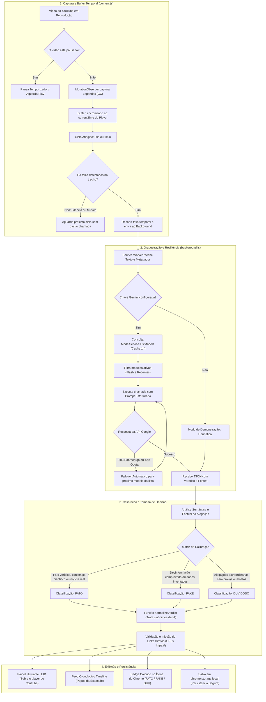

# VerificaVídeo: Fato ou Fake em Tempo Real 🔍🎬

[](https://developer.chrome.com/docs/extensions/mv3/intro/)
[](https://ai.google.dev/)
[](LICENSE)
[](https://github.com/)

Extensão *open-source* para o Google Chrome (**Manifest V3**) que realiza **auditoria e checagem de fatos contínua em tempo real** de vídeos e transmissões ao vivo no YouTube utilizando a inteligência artificial do **Google Gemini**.

A extensão monitora as legendas a cada **30 segundos ou 1 minuto**, classifica cada alegação falada entre **`[FATO]`**, **`[FAKE]`** ou **`[DUVIDOSO]`**, e fornece **links diretos e clicáveis** para agências jornalísticas oficiais de checagem.

---

## 📑 Sumário

- [Visão Geral](#-visão-geral)
- [Fluxograma de Funcionamento e Calibração](#-fluxograma-de-funcionamento-e-calibração)
- [Critérios de Calibração (Fato, Fake ou Duvidoso)](#-critérios-de-calibração-fato-fake-ou-duvidoso)
- [Guia Rápido de Instalação (Passo a Passo)](#-guia-rápido-de-instalação-passo-a-passo)
- [Como Configurar a Chave da API Gemini](#-como-configurar-a-chave-da-api-gemini)
- [Como Usar no YouTube](#-como-usar-no-youtube)
- [Arquitetura de Resiliência Técnica](#-arquitetura-de-resiliência-técnica)
- [Estrutura do Repositório](#-estrutura-do-repositório)
- [Perguntas Frequentes & Solução de Problemas](#-perguntas-frequentes--solução-de-problemas)
- [Licença e Contribuição](#-licença-e-contribuição)

---

## 💡 Visão Geral

Ao assistir a vídeos jornalísticos, entrevistas, podcasts ou debates políticos no YouTube, o **VerificaVídeo**:
1. Captura o áudio transcrito em blocos temporais (30s ou 1min).
2. Pausa automaticamente se você pausar o vídeo e retoma assim que der play.
3. Exibe um **Painel Flutuante (HUD)** diretamente sobre o vídeo no YouTube.
4. Gera um **Feed Histórico (Timeline)** no popup que **nunca se perde** ao fechar a janela.
5. Inclui **links diretos para fontes oficiais** (Agência Lupa, Aos Fatos, G1 Fato ou Fake, OMS, IBGE, etc.).

---

## 📊 Fluxograma de Funcionamento e Calibração

O diagrama abaixo ilustra todo o ciclo de vida: desde a captura das legendas no player até o processamento na IA, calibração do veredito e exibição ao usuário.



---

## ⚖️ Critérios de Calibração (Fato, Fake ou Duvidoso)

Para evitar que a IA caia na "hipercautela" (classificando tudo como Duvidoso), o modelo é instruído sob a seguinte matriz analítica:

| Veredito | Significado | Quando é Calibrado? | Exemplos Práticos |
| :---: | :---: | :--- | :--- |
| 🟢<br>**`[FATO]`** | **Verdadeiro** | Informação comprovada, dados oficiais, conhecimentos consolidados pela ciência, fatos históricos ou declarações plausíveis e relatos do apresentador sem falsidade. | *"O PIB brasileiro cresceu segundo o IBGE"*, *"A água atinge ebulição a 100°C ao nível do mar"*, explicações factuais e honestas do vídeo. |
| 🔴<br>**`[FAKE]`** | **Falso** | Desinformação explícita, boatos desmentidos por agências jornalísticas, dados fabricados, teorias da conspiração ou promessas perigosas. | *"Chá de alho cura qualquer câncer"*, *"A Terra é plana"*, alegações golpistas ou fake news eleitorais desmentidas. |
| 🟡<br>**`[DUVIDOSO]`** | **Não Comprovado** | Alegações extraordinárias, polêmicas ou bombásticas que demandam comprovação formal, mas que o autor diz sem citar fontes ou sem respaldo independente. | *"Descobri em segredo que tal empresa vai quebrar amanhã"*, tratamentos milagrosos sem testes, rumores de bastidores. |

> [!NOTE]
> **Normalização de Sinônimos (`normalizeVerdict`):** Se a IA responder variações em linguagem natural como *"Verdadeiro"*, *"Correto"*, *"Falso"*, *"Enganoso"* ou *"Desinformação"*, o algoritmo normaliza de forma determinística para os padrões oficiais `[FATO]`, `[FAKE]` ou `[DUVIDOSO]`.

---

## 🛠️ Guia Rápido de Instalação (Passo a Passo)

Qualquer pessoa pode rodar o projeto em menos de 2 minutos diretamente no Chrome:

### 1. Baixar o Código
* Clone o repositório ou baixe o arquivo ZIP do projeto no GitHub:
  ```bash
  git clone https://github.com/SEU_USUARIO/VerificaVideo.git
  ```

### 2. Abrir o Gerenciador de Extensões do Chrome
* No navegador Google Chrome, digite na barra de endereços:  
  `chrome://extensions/` e pressione `Enter`.
* *(Ou vá no menu de 3 pontinhos do Chrome > **Extensões** > **Gerenciar extensões**)*.

### 3. Ativar o Modo do Desenvolvedor
* No canto superior direito da tela, ative a chave seletora **"Modo do desenvolvedor"** (*Developer mode*).

### 4. Carregar a Extensão
* No canto superior esquerdo, clique no botão **"Carregar sem compactação"** (*Load unpacked*).
* Selecione a pasta onde o projeto foi descompactado (ex: `d:\Check_Fatos_Tempo_Real`).
* Pronto! A extensão **VerificaVídeo** estará pronta para uso.

### 5. Fixar na Barra de Ferramentas
* Clique no ícone de **quebra-cabeça (🧩)** no topo do Chrome e clique no alfinete **📌** ao lado de **VerificaVídeo** para manter o ícone visível.

---

## 🔑 Como Configurar a Chave da API Gemini

> [!IMPORTANT]
> **Você NÃO precisa alterar arquivos de código!**  
> A chave é configurada diretamente na janela da extensão e armazenada de forma segura e local no seu próprio navegador (`chrome.storage.local`).

1. **Obter chave gratuita no Google AI Studio:**
   * Acesse [Google AI Studio](https://aistudio.google.com).
   * Faça login com sua conta Google e clique em **"Get API key"** > **"Create API key"**.
   * Copie o código gerado (`AIzaSy...`).

2. **Inserir na Extensão:**
   * Clique no ícone da extensão **VerificaVídeo** na barra superior do navegador.
   * O campo **"Configurar Chave da API Gemini"** abrirá automaticamente na primeira vez.
   * Cole sua chave no campo e clique em **Salvar**.
   * O botão exibirá **"Salvo!"** em verde e o selo no canto superior mudará para **`IA Gemini Ativa`**.

---

## 📺 Como Usar no YouTube

1. Abra qualquer vídeo ou live no [YouTube](https://www.youtube.com).
2. **Ative as Legendas (CC):** clique no botão **"CC"** no player do YouTube para que as falas sejam legendadas.
3. Abra a extensão **VerificaVídeo**.
4. Escolha a frequência desejada: **`30 Segundos`** ou **`1 Minuto`**.
5. Clique em:  
   👉 **"Iniciar Monitoramento em Tempo Real"**.
6. **Dê play no vídeo:**
   * Você pode dar play na análise antes e depois dar play no vídeo.
   * A extensão detecta o estado do player: se o vídeo for pausado, ela aguarda sem gastar chamadas desnecessárias.
7. **Acompanhe os Vereditos:**
   * No **Painel Flutuante (HUD)** sobre o vídeo no YouTube.
   * No **Feed Cronológico (Timeline)** dentro da janela da extensão, com links diretos para as fontes.
8. **Persistência dos Resultados:**
   * As análises **nunca somem ao fechar a janela**. Elas só são reiniciadas se você clicar em iniciar uma nova checagem ou no botão **"Limpar"**.

---

## 🛡️ Arquitetura de Resiliência Técnica

A extensão foi projetada para garantir **100% de disponibilidade**, sem quebras inesperadas:

* **Descoberta Dinâmica via `ListModels`:** Em vez de depender de nomes estáticos no código, o Service Worker consulta o endpoint de catálogo da Google (`/v1beta/models`) e descobre quais modelos estão ativos para a sua conta e região no momento, priorizando modelos ultrarrápidos da família `Flash`.
* **Tratamento de Sobrecarga (Erro 503 e 429):** Se o modelo principal sofrer um pico temporário de alta demanda, a extensão rotaciona automaticamente para outros modelos disponíveis na conta.
* **Degradação Elegante (Modo de Contingência):** Caso todos os servidores mundiais da Google sofram indisponibilidade simultânea, a extensão entrega uma análise heurística estruturada com o aviso de contingência, sem travar a interface do usuário.
* **Abertura Segura de Links:** Utiliza `chrome.tabs.create` para garantir que o clique em links de agências abra novas abas sem conflitos de sandbox com a janela popup.

---

## 📁 Estrutura do Repositório

```text
Check_Fatos_Tempo_Real/
├── manifest.json         # Manifesto Manifest V3 (permissões, scripts e metadados)
├── popup.html            # Interface moderna minimalista da extensão
├── popup.css             # Estilização escura responsiva com badges dinâmicos
├── popup.js              # Controlador da UI, persistência e comunicação de eventos
├── content.js            # Injetado no YouTube: buffer temporal, captura e HUD flutuante
├── background.js         # Service Worker: orquestração, IA Gemini e resiliência
├── icons/                # Ícones da extensão (16x16, 48x48 e 128x128 px)
│   ├── icon16.png
│   ├── icon48.png
│   └── icon128.png
├── .gitignore            # Arquivos ignorados pelo Git
├── LICENSE               # Licença MIT Open Source
└── README.md             # Esta documentação completa
```

---

## ❓ Perguntas Frequentes & Solução de Problemas

### 1. Posso usar a extensão sem chave da API?
**Sim.** A extensão inclui um modo de demonstração estruturado. Ao inserir sua chave gratuita do Gemini, ela passa a analisar com IA generativa em tempo real.

### 2. A extensão deu aviso "Nenhuma fala detectada nos últimos segundos":
* Certifique-se de que o botão **CC (Legendas)** está ligado no player do YouTube.
* Deixe o vídeo reproduzir por alguns segundos para que algumas frases apareçam na tela. Trechos apenas com música instrumental não possuem falas para auditoria.

### 3. Minha chave de API é compartilhada com alguém?
**Não.** A chave é salva apenas no armazenamento local criptografado do seu próprio navegador Google Chrome (`chrome.storage.local`). As requisições saem diretamente do seu navegador para os servidores oficiais da Google API, sem intermediários.

---

## 📄 Licença e Contribuição

Este projeto é disponibilizado sob a licença **MIT** — sinta-se à vontade para utilizar, modificar e distribuir.  
Contribuições via *Pull Requests* ou sugestões via *Issues* são muito bem-vindas!
